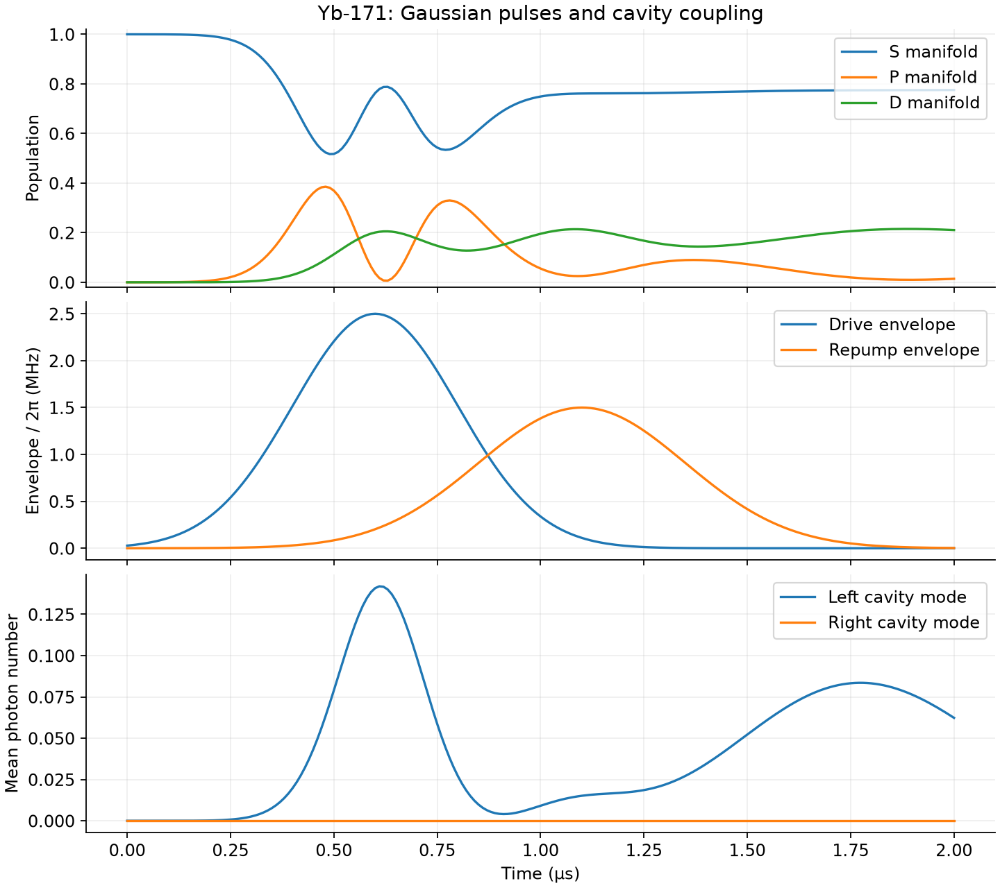

# CAIPE-sim — Yb-171 ion-cavity dynamics

An exploratory simulator for driven Yb-171 ions, combining a 16-state hyperfine
basis, polarization-resolved couplings, Gaussian drive and repump pulses, and
two cavity modes. QuTiP solves the dissipative dynamics; Matplotlib provides
interactive controls and exported figures.

This project began as a collaborative three-level cavity-assisted ion-photon
entanglement simulation and developed into the Yb-171 model. The portfolio focus
is the pulse-enabled Yb-171 application. See [model status](docs/model-status.md)
for the assumptions and scientific validation still needed.
The primary physics reference is C. J. Foot's *Atomic Physics* (Oxford, 2005).
See the [physics reference guide](docs/physics-references.md) for the textbook
sections, the Ward cavity model, and the separately verified Yb inputs.



## Run the demonstration

Python 3.12 or newer is required. From this checkout, using uv:

```bash
uv sync
uv run caipe-sim --demo
```

This runs the full 16-state atomic basis with two small cavity modes on CPU and
writes `outputs/yb171_demo.png` and `outputs/yb171_demo.npz`. The plot shows
manifold populations, Gaussian pulse envelopes, and cavity photon numbers.
The NPZ file contains the arrays for independent analysis. The illustrative
parameters are not a fit to experimental data.

To open the interactive application on a machine with a graphical Matplotlib
backend:

```bash
uv run caipe-sim
```

The UI exposes drive/repump amplitudes, centers and widths, detunings, magnetic
field, polarization, decay, and cavity parameters. Its default run starts in
`S, F=0, mF=0`. Its three displayed atomic populations are selected state groups,
not a complete partition of all 16 states; the exported demo uses full S/P/D
manifold projectors.

Without uv:

```bash
python -m venv .venv
# Activate the environment using your platform's command.
python -m pip install -e . pytest
python -m caipe_sim --demo
python -m caipe_sim
```

The current application uses CPU QuTiP. Optional JAX and notebook dependencies
are available as extras for the older experiments; a GPU is not required to
install or run the portfolio demo. Historical calcium examples may require
additional atomic-physics data outside the current application.

## Validate the model numerically

```bash
uv run pytest
uv run python examples/flopping_mini_smoketest.py
```

The active tests check basis completeness, selection rules, Hermiticity,
population conservation, finite/nonnegative observables, excitation and cavity
response, a stationary ground-state limit, and a Gaussian pulse against an
analytic resonant Rabi solution. These checks do not establish experimental
accuracy. GitHub Actions runs the CPU checks and exports the demo.

Historical tests targeting the original three-level API remain under
`tests/tests/` and `caipe_sim/`; default pytest collection explicitly selects
`tests/portfolio/`. See the [model status](docs/model-status.md) for the remaining
validation and consolidation work.

## Code map

| Path | Purpose |
| --- | --- |
| `src/caipe_sim/yb171_simulator.py` | Active pulse-enabled model and interactive UI |
| `src/caipe_sim/Yb171.py` | Self-contained atomic level data |
| `src/caipe_sim/demo.py` | Small headless run and figure/data export |
| `src/caipe_sim/app_main.py` | Installed command-line interface |
| `tests/portfolio/` | Active numerical and analytic validation |
| `examples/` | Launchers and historical model experiments |
| `notebooks/` | Original physics notes and reports |
| `docs/` | Repository review and model limitations |

The older `hamiltonian_utils.py`, `interactive_ui.py`, and batch modules are
preserved development versions; the portfolio CLI uses `yb171_simulator.py`.
Their results should not be assumed equivalent without reconciliation.

.
