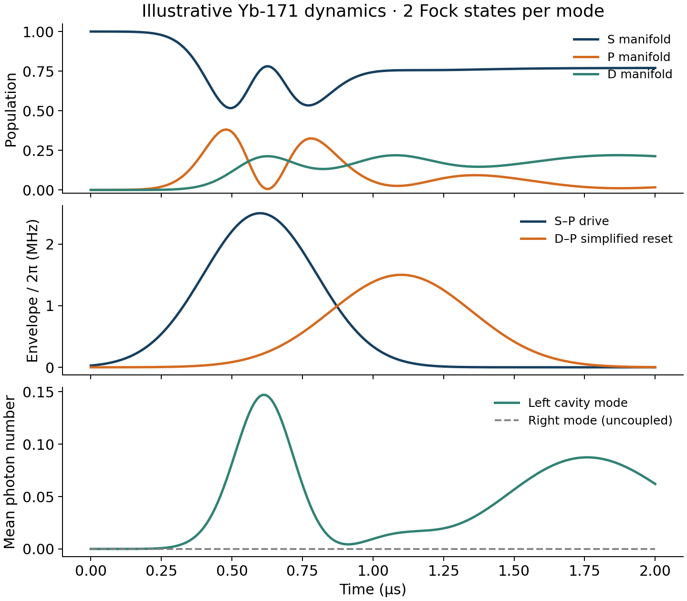
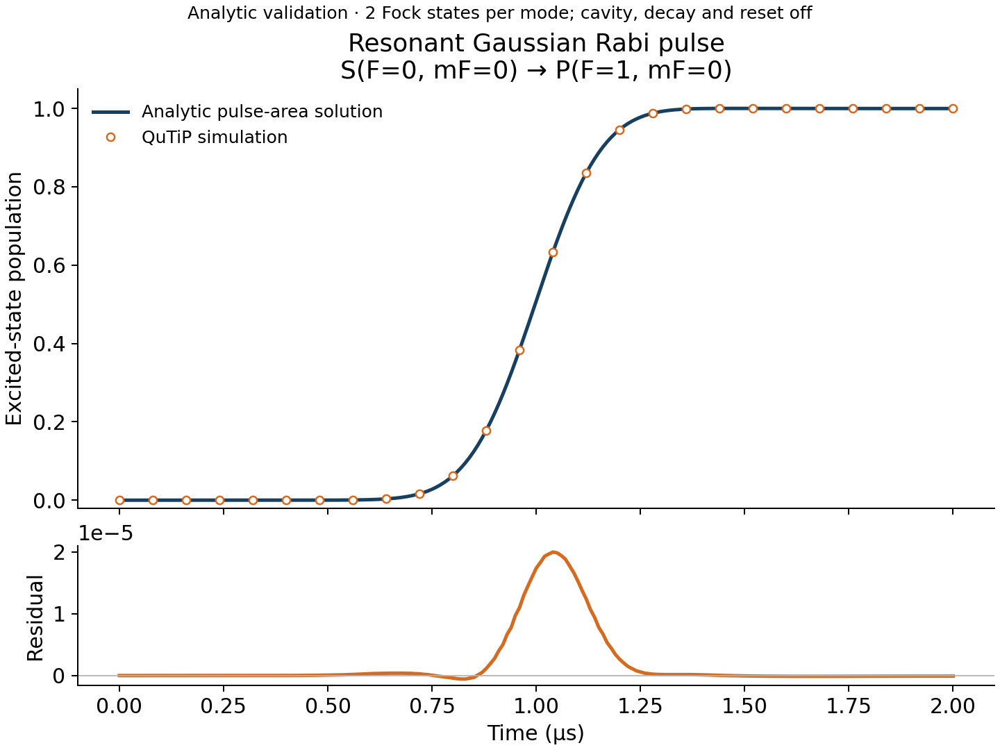

# CAIPE-sim — Yb-171 ion–photon emission

[](https://github.com/FelixVelasquez1025/Cavity-Assisted-Ion-Photon-Emission-Sim/actions/workflows/tests.yml)

Open-system simulation of a driven Yb-171 ion coupled to a two-polarization optical cavity, built to study cavity-assisted ion–photon emission.



Illustrative demo with 4 Fock states per mode; maximum 4−5 differences: populations 2.413e-4, photon numbers 7.532e-5.

## How it works

A 369 nm Gaussian pulse drives the ion from S to P. The cavity on the 2.438 µm D3/2–P1/2 line enhances P→D emission into the selected circular-polarization mode. A D→P reset coupling returns population toward S through P→S decay; it is a simplified stand-in for the 935 nm repump via 3D[3/2]1/2.

## What it models

- A 16-state F,mF basis: S1/2 and P1/2 each have F=0,1; D3/2 has F=1,2.
- A 369.52604 nm S–P Gaussian drive and a D3/2→P1/2 reset coupling. The intermediate 935 nm pathway is not simulated.
- Two circular-polarization spaces on the **2.438 µm D3/2–P1/2 cavity line**; one polarization couples per run.
- P→S and P→D loss, cavity leakage and S/D dephasing, with explicit but unnormalized decay-input conventions.
- CPU QuTiP master-equation evolution, a Matplotlib UI, and headless population/photon-number exports.

## Atomic inputs

Fixed atomic inputs are sourced; uncertainties, component assignments and the NIST derivation are in the [source guide][sources].

| Quantity | Value | Units | Source |
| --- | --- | --- | --- |
| S–P vacuum wavelength | 369.52604 | nm | PRA 83, 013406, Table III; [sources] |
| D–P vacuum Ritz wavelength | 2438.417759 | nm | NIST ASD level difference; [sources] |
| P1/2 lifetime | 8.12 | ns | PRA 80, 022502; [sources] |
| P→D branching fraction | 0.00501 | fraction | PRA 76, 052314; [sources] |

## Simulation settings

These demo inputs are illustrative. Amplitudes and decay settings are model scales; see the [exact conventions](docs/model-status.md#exact-amplitude-convention-behavior-preserved).

| Quantity | Value | Units | Source |
| --- | --- | --- | --- |
| Drive amplitude input | 5 | MHz | [demo] |
| Reset amplitude input | 3 | MHz | [demo] |
| Drive pulse centre | 0.6 | µs | [demo] |
| Reset pulse centre | 1.1 | µs | [demo] |
| Drive Gaussian sigma | 0.2 | µs | [demo] |
| Reset Gaussian sigma | 0.25 | µs | [demo] |
| Drive detuning | 0 | MHz | [demo] |
| Reset detuning | 0 | MHz | [demo] |
| Cavity detuning | 0 | MHz | [demo] |
| Magnetic field | 0 | G | [demo] |
| Cavity coupling input | 0.5 | MHz | [demo] |
| κ/(2π) | 0.1 | MHz | [demo] |
| γ_SP/(2π) | 0.01 | MHz | [demo] |
| γ_DP/(2π) | 0.01 | MHz | [demo] |
| S dephasing input | 0.000136 | MHz | [demo] |
| D dephasing input | 0.000136 | MHz | [demo] |
| Initial atomic state | S,F=0,mF=0 | — | [demo] |
| Coupled mode | left | — | [demo] |
| Initial time | 0 | µs | [demo] |
| Final time | 2 | µs | [demo] |
| Time samples | 201 | count | [demo] |
| Fock dimension per mode | 4 | count | [Truncation decision](docs/fock-convergence.md) |

The UI starts in the same atomic state, left polarization, coupling and cavity loss, with its own field and pulse settings.

## Validation



Analytic Gaussian pulse-area comparison: maximum absolute population residual **3.40955548e-7**, with solver atol=1e-10 and rtol=1e-8; [shared Rabi test](tests/test_yb171.py).

[Tests](tests/) and reproducible scripts check:

- Selection rules and basis completeness.
- Hamiltonian Hermiticity.
- Population conservation and finite, nonnegative observables.
- Analytic resonant Rabi evolution.
- Signed hyperfine coefficients against evaluated Wigner 3j/6j reference values.
- Zeeman slopes against Foot’s analytic Landé g_F formula (§6.3).
- Fock truncation at dimensions 2, 3, 4 and 5: every **4 versus 5 difference is below 1e-3**, so the default is 4 for this demo sequence.

Numerical checks, correction comparisons and their scope are in [validation notes](docs/validation-notes.md).

## Quickstart

With Python 3.12+ and uv installed:

```bash
git clone https://github.com/FelixVelasquez1025/Cavity-Assisted-Ion-Photon-Emission-Sim.git
cd Cavity-Assisted-Ion-Photon-Emission-Sim
uv sync --locked
uv run pytest
uv run caipe-sim --demo
uv run python scripts/make_readme_figures.py
uv run python scripts/check_fock_truncation.py
```

The demo writes PNG/NPZ files to `outputs/`; the figure script regenerates `docs/figures/`. For the UI on a graphical desktop, run from the repository root:

```bash
uv run caipe-sim
```

Direct-file launching also works with the project environment:
`uv run python src/caipe_sim/yb171_simulator.py`. In an editor, select the
repository’s `.venv` Python interpreter so its scientific dependencies are available.

## Limitations

Inputs are illustrative and not fitted to experiment. The model uses the RWA, linear weak-field S/D Zeeman shifts, Markovian losses and a finite Fock basis. Hyperfine splittings are absent from the diagonal energies. The missing P Zeeman term, unnormalized decay scales and truncation sensitivity also limit quantitative interpretation. See [model status](docs/model-status.md) and [validation notes](docs/validation-notes.md).

### Next steps

- Complete the detuning/energy map, physical decay calibration and truncation study.
- Evolve both cavity polarizations simultaneously for the intended protocol.
- Add pulse-resolved cavity-output correlations.
- Separate useful output flux from other losses.

Current plots do not establish emission probability, indistinguishability or polarization entanglement.

## Origin

Grew out of a collaborative three-level model, preserved with the historical calcium examples in [archive/](archive/README.md). Licensed under [MIT](LICENSE).

## References

C. J. Foot, *Atomic Physics* (Oxford, 2005). Thomas Walker, *Single Photons from a Trapped-Ion Cavity-QED System* (Sussex PhD, June 2020).

Atomic data: [wavelengths, PRA 83, 013406](https://doi.org/10.1103/PhysRevA.83.013406); [P lifetime, PRA 80, 022502](https://doi.org/10.1103/PhysRevA.80.022502); [D lifetime, PRA 61, 022507](https://doi.org/10.1103/PhysRevA.61.022507); [auxiliary lifetime, J. Phys. B 26, L701](https://doi.org/10.1088/0953-4075/26/20/003); [branching and HFS, PRA 76, 052314](https://doi.org/10.1103/PhysRevA.76.052314); [S HFS, IEEE UFFC 44, 344](https://doi.org/10.1109/58.585119); [P HFS, PRA 49, 3351](https://doi.org/10.1103/PhysRevA.49.3351); [magnetic conventions, arXiv:2509.04416](https://arxiv.org/abs/2509.04416); [NIST ASD](https://doi.org/10.18434/T4W30F). Scope and source-precision qualifications are in [sources].

[demo]: src/caipe_sim/demo.py
[sources]: docs/physics-references.md
